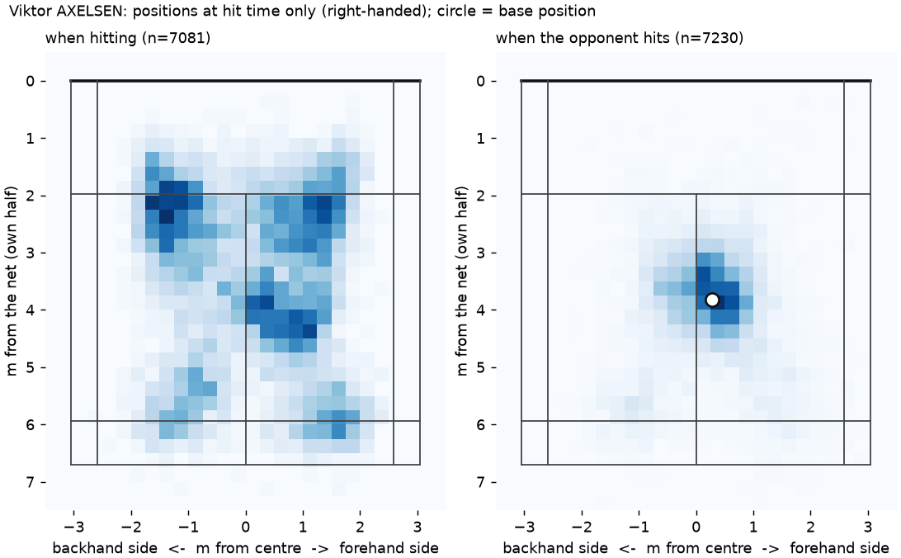
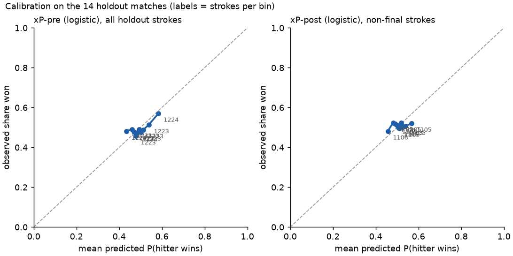
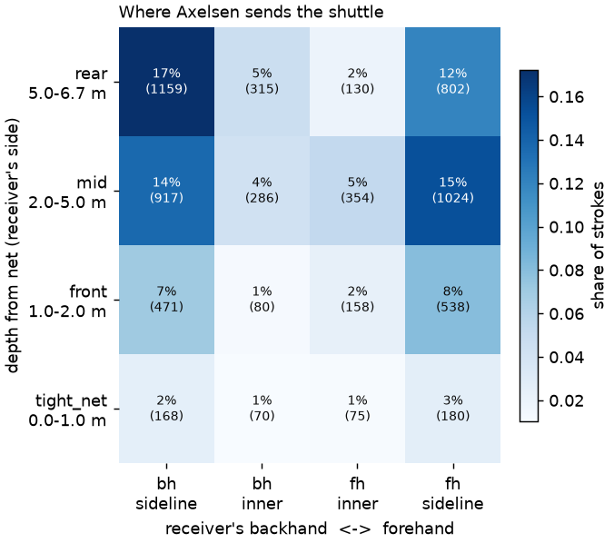
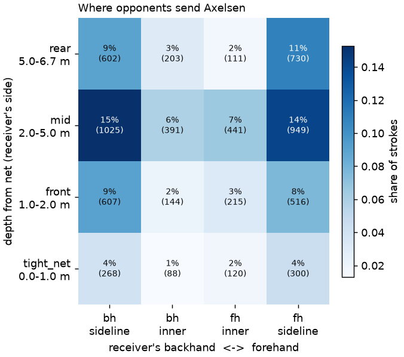

# Tactical report: Viktor AXELSEN

_Generated 2026-11-04 by `python -m tactics report --player 'Viktor AXELSEN'`._

## Coverage

- Matches: 20 (2 of them in the holdout set, see docs/EVALUATION.md)
- Rallies with a known outcome: 1394; strokes: 15773
- Overall rally win rate: 58.1% (95% CI 55.5%-60.7%)
- Opponents: Anders ANTONSEN, Anthony Sinisuka GINTING, CHEN Long, Hans-Kristian Solberg VITTINGHUS, Jonatan CHRISTIE, Kento MOMOTA, Kodai NARAOKA, Kunlavut VITIDSARN, LEE Zii Jia, LIEW Daren, Lakshya SEN, NG Ka Long Angus, Rasmus GEMKE, SHI Yuqi, ZHAO Jun Peng
- Shot vocabulary: 10 coarse types; minimum n = 30 on both sides of every comparison; handedness: right
- "Typical pros" = all other players in the dataset in the same situation (receiving the same shot to the same zone, or playing it); Axelsen is never part of Axelsen's own reference.

## Top insights

Where Axelsen differs most from typical pros, among patterns a coach can act on mid-match. Ranked by the smallest difference the data still supports (the 95% interval bound nearest zero), with at most 2 per table. Only patterns selected in at least 50% of the leave-one-match-out folds are ranked (the top-5 is re-selected 20 times, each time without one match); the rest are listed under 'less stable'. `tentative` = the interval on the difference is wider than 20 points or n is under 60.

| #   | insight                                                                                                                                                                                                                                 | stable in      | flag      |
|:----|:----------------------------------------------------------------------------------------------------------------------------------------------------------------------------------------------------------------------------------------|:---------------|:----------|
| 1   | When opponents play anything to Axelsen's body, Axelsen loses the point within two shots 7% of the time (n=97, 95% CI 4%-14%); typical pros lose 20% after the same shot (difference -13 points, 95% CI -18 to -5, n=635).              | 11 of 20 folds |           |
| 2   | When opponents play a net shot to Axelsen's front forehand, Axelsen loses the point within two shots 7% of the time (n=751, 95% CI 6%-10%); typical pros lose 14% after the same shot (difference -7 points, 95% CI -8 to -4, n=6410).  | 20 of 20 folds |           |
| 3   | When opponents smash to Axelsen's mid forehand, Axelsen loses the point within two shots 16% of the time (n=472, 95% CI 13%-19%); typical pros lose 23% after the same shot (difference -7 points, 95% CI -11 to -4, n=3544).           | 15 of 20 folds |           |
| 4   | In game 3, when opponents clear, wherever it lands, Axelsen loses the point within two shots 24% of the time (n=46, 95% CI 14%-38%); typical pros lose 11% after the same shot (difference +13 points, 95% CI +3 to +28, n=904).        | 18 of 20 folds | tentative |
| 5   | When Axelsen plays anything to the opponent's mid forehand, Axelsen loses the point within two shots 6% of the time (n=1342, 95% CI 5%-7%); typical pros lose 10% after the same shot (difference -4 points, 95% CI -5 to -2, n=10215). | 10 of 20 folds |           |

## How to play against Axelsen

For an opponent. Each line is a situation where Axelsen's record differs from typical pros with 95% confidence; 'loses within two shots' means the point ended within two strokes of that shot and Axelsen lost it.

- **In game 3, clear more.** Axelsen loses the point within two shots 24% of the time there, vs 11% for typical pros (n=46).
- **Push or rush to Axelsen's rear backhand.** Axelsen loses the point within two shots 35% of the time there, vs 23% for typical pros (n=81).
- **In game 3, attack Axelsen's front backhand.** Axelsen loses the point within two shots 18% of the time there, vs 11% for typical pros (n=118).
- **Axelsen's body is well covered.** Axelsen loses within two shots only 7% of the time, vs 20% for typical pros (n=97).
- **Smashes are less effective than usual.** Axelsen loses within two shots only 18% of the time, vs 26% for typical pros (n=967).
- **Don't count on net shots to Axelsen's front forehand.** Axelsen loses within two shots only 7% of the time, vs 14% for typical pros (n=751).

## What Axelsen should fix

Situations where Axelsen loses more often than typical pros.

- **In game 3, defending clears.** Axelsen loses the point within two shots 24% of the time there, vs 11% for typical pros (n=46).
- **Defending pushes and rushes to the rear backhand.** Axelsen loses the point within two shots 35% of the time there, vs 23% for typical pros (n=81).
- **In game 3, covering the front backhand.** Axelsen loses the point within two shots 18% of the time there, vs 11% for typical pros (n=118).

## The evidence: danger tables

Each row: probability that Axelsen loses the point within two shots after that shot, with the same probability for typical pros and the difference in percentage points (Newcombe 95% interval). `signal` = the interval excludes zero; `too few` = under 30 strokes; `ref too few` = under 30 in the reference. Zones are always from the receiver's point of view, forehand/backhand by their handedness; shots the rally ended on with an out or net error are excluded (they are outcomes, not targets).

### Shots Axelsen faces

Baseline over all shots Axelsen faces: 10.9%.

| opponent shot -> zone   |   n | lost within 2   | 95% CI   | typical pros   | difference (95% CI)   | flag   |
|:------------------------|----:|:----------------|:---------|:---------------|:----------------------|:-------|
| push_rush -> rear_bh    |  81 | 35%             | 25%-45%  | 23% (n=1385)   | +11 (+2 to +23)       | signal |
| push_rush -> mid_fh     | 110 | 22%             | 15%-30%  | 27% (n=804)    | -6 (-13 to +3)        |        |
| push_rush -> rear_fh    | 149 | 20%             | 14%-27%  | 17% (n=1797)   | +3 (-3 to +10)        |        |
| lob -> mid_fh           |  32 | 0%              | 0%-11%   | 9% (n=318)     | -9 (-13 to +2)        |        |
| lob -> rear_fh          | 360 | 5%              | 3%-7%    | 9% (n=4983)    | -4 (-6 to -1)         | signal |
| smash -> mid_bh         | 408 | 16%             | 13%-20%  | 23% (n=3761)   | -7 (-11 to -3)        | signal |
| drop -> mid_bh          | 324 | 6%              | 4%-9%    | 10% (n=1826)   | -4 (-7 to -1)         | signal |
| smash -> mid_fh         | 472 | 16%             | 13%-19%  | 23% (n=3544)   | -7 (-11 to -4)        | signal |
| defensive -> front_bh   | 206 | 6%              | 4%-10%   | 10% (n=1822)   | -4 (-7 to +0)         |        |
| defensive -> mid_bh     | 203 | 6%              | 4%-11%   | 10% (n=1731)   | -3 (-6 to +1)         |        |
| defensive -> mid_fh     | 229 | 7%              | 4%-11%   | 9% (n=1918)    | -2 (-5 to +2)         |        |
| net -> front_fh         | 751 | 7%              | 6%-10%   | 14% (n=6410)   | -7 (-8 to -4)         | signal |

By shot type alone:

| opponent shot   |    n | lost within 2   | 95% CI   | typical pros   | difference (95% CI)   | flag   |
|:----------------|-----:|:----------------|:---------|:---------------|:----------------------|:-------|
| push_rush       |  495 | 21%             | 18%-25%  | 23% (n=5189)   | -1 (-5 to +3)         |        |
| smash           |  967 | 18%             | 16%-21%  | 26% (n=8047)   | -8 (-10 to -5)        | signal |
| drop            |  897 | 7%              | 6%-9%    | 10% (n=6423)   | -3 (-5 to -1)         | signal |
| defensive       |  916 | 8%              | 6%-9%    | 10% (n=8343)   | -3 (-4 to -1)         | signal |
| lob             |  919 | 8%              | 7%-10%   | 10% (n=11584)  | -2 (-4 to -0)         | signal |
| clear           |  520 | 9%              | 7%-12%   | 11% (n=6350)   | -2 (-4 to +1)         |        |
| net             | 1701 | 10%             | 8%-11%   | 14% (n=13692)  | -4 (-6 to -3)         | signal |
| drive           |  262 | 11%             | 8%-15%   | 12% (n=2135)   | -1 (-4 to +4)         |        |

By zone alone:

| zone on Axelsen's side   |    n | lost within 2   | 95% CI   | typical pros   | difference (95% CI)   | flag   |
|:-------------------------|-----:|:----------------|:---------|:---------------|:----------------------|:-------|
| rear_bh                  |  799 | 15%             | 12%-17%  | 15% (n=10280)  | -0 (-2 to +3)         |        |
| front_fh                 | 1138 | 8%              | 6%-9%    | 13% (n=10115)  | -5 (-7 to -3)         | signal |
| body                     |   97 | 7%              | 4%-14%   | 20% (n=635)    | -13 (-18 to -5)       | signal |
| mid_fh                   | 1328 | 12%             | 10%-14%  | 16% (n=10229)  | -4 (-5 to -2)         | signal |
| front_bh                 | 1092 | 10%             | 9%-12%   | 13% (n=9238)   | -3 (-5 to -1)         | signal |
| rear_fh                  |  839 | 11%             | 9%-14%   | 12% (n=10119)  | -1 (-3 to +1)         |        |
| mid_bh                   | 1384 | 11%             | 9%-12%   | 16% (n=11147)  | -5 (-7 to -3)         | signal |

### Shots Axelsen plays

Baseline over all of Axelsen's shots: 7.5%.

| shot -> opponent zone   |   n | lost within 2   | 95% CI   | typical pros   | difference (95% CI)   | flag   |
|:------------------------|----:|:----------------|:---------|:---------------|:----------------------|:-------|
| clear -> rear_bh        | 170 | 14%             | 9%-19%   | 12% (n=2631)   | +1 (-3 to +7)         |        |
| smash -> mid_fh         | 517 | 3%              | 2%-5%    | 6% (n=3499)    | -3 (-4 to -1)         | signal |
| drop -> mid_fh          | 135 | 3%              | 1%-7%    | 6% (n=2113)    | -3 (-6 to +1)         |        |
| net -> front_bh         | 566 | 11%             | 8%-13%   | 10% (n=6292)   | +1 (-2 to +4)         |        |
| drop -> mid_bh          |  99 | 4%              | 2%-10%   | 6% (n=2051)    | -2 (-5 to +4)         |        |
| smash -> mid_bh         | 453 | 5%              | 3%-7%    | 6% (n=3716)    | -2 (-4 to +1)         |        |
| drive -> mid_fh         |  68 | 10%             | 5%-20%   | 9% (n=689)     | +2 (-4 to +11)        |        |
| push_rush -> mid_bh     |  79 | 10%             | 5%-19%   | 12% (n=1110)   | -2 (-7 to +7)         |        |
| defensive -> mid_bh     | 251 | 10%             | 7%-14%   | 11% (n=1683)   | -1 (-4 to +3)         |        |
| push_rush -> rear_bh    | 165 | 5%              | 3%-10%   | 9% (n=1301)    | -4 (-7 to +1)         |        |
| lob -> mid_bh           |  39 | 10%             | 4%-24%   | 22% (n=509)    | -12 (-19 to +2)       |        |
| defensive -> front_bh   | 164 | 9%              | 6%-15%   | 11% (n=1864)   | -2 (-6 to +4)         |        |

By shot type alone:

| shot      |    n | lost within 2   | 95% CI   | typical pros   | difference (95% CI)   | flag   |
|:----------|-----:|:----------------|:---------|:---------------|:----------------------|:-------|
| clear     |  256 | 12%             | 9%-17%   | 14% (n=6614)   | -1 (-5 to +3)         |        |
| smash     | 1035 | 4%              | 3%-5%    | 6% (n=7979)    | -2 (-3 to -1)         | signal |
| drop      |  338 | 5%              | 3%-8%    | 8% (n=6982)    | -3 (-5 to +0)         |        |
| drive     |  232 | 9%              | 6%-13%   | 8% (n=2165)    | +1 (-2 to +5)         |        |
| net       | 1513 | 9%              | 7%-10%   | 10% (n=13880)  | -1 (-3 to +0)         |        |
| defensive | 1068 | 8%              | 7%-10%   | 12% (n=8191)   | -3 (-5 to -1)         | signal |
| lob       | 1748 | 8%              | 7%-9%    | 12% (n=10755)  | -4 (-5 to -2)         | signal |
| push_rush |  510 | 8%              | 6%-10%   | 10% (n=5174)   | -2 (-4 to +1)         |        |

By zone alone:

| opponent zone   |    n | lost within 2   | 95% CI   | typical pros   | difference (95% CI)   | flag   |
|:----------------|-----:|:----------------|:---------|:---------------|:----------------------|:-------|
| body            |   51 | 12%             | 6%-23%   | 11% (n=681)    | +1 (-6 to +13)        |        |
| front_bh        |  777 | 10%             | 8%-12%   | 10% (n=9553)   | -0 (-2 to +2)         |        |
| mid_fh          | 1342 | 6%              | 5%-7%    | 10% (n=10215)  | -4 (-5 to -2)         | signal |
| rear_bh         | 1472 | 8%              | 7%-10%   | 11% (n=9607)   | -3 (-4 to -1)         | signal |
| mid_bh          | 1189 | 7%              | 6%-9%    | 9% (n=11342)   | -2 (-3 to -0)         | signal |
| rear_fh         |  928 | 7%              | 6%-9%    | 10% (n=10030)  | -3 (-4 to -1)         | signal |
| front_fh        |  941 | 7%              | 6%-9%    | 10% (n=10312)  | -3 (-5 to -1)         | signal |

### Game 3 only

Shots Axelsen faces:

| opponent shot -> zone   |   n | lost within 2   | 95% CI   | typical pros   | difference (95% CI)   | flag   |
|:------------------------|----:|:----------------|:---------|:---------------|:----------------------|:-------|
| smash -> mid_fh         |  66 | 23%             | 14%-34%  | 21% (n=643)    | +2 (-7 to +14)        |        |
| lob -> rear_bh          |  48 | 4%              | 1%-14%   | 11% (n=962)    | -6 (-10 to +4)        |        |
| defensive -> front_fh   |  32 | 3%              | 1%-16%   | 9% (n=458)     | -6 (-10 to +7)        |        |
| lob -> rear_fh          |  52 | 6%              | 2%-16%   | 8% (n=858)     | -2 (-7 to +8)         |        |
| net -> front_bh         |  80 | 18%             | 11%-27%  | 13% (n=1229)   | +5 (-2 to +15)        |        |
| net -> front_fh         |  96 | 10%             | 6%-18%   | 13% (n=1294)   | -3 (-8 to +5)         |        |
| smash -> mid_bh         |  51 | 14%             | 7%-26%   | 20% (n=654)    | -6 (-14 to +6)        |        |

Shots Axelsen plays:

| shot -> opponent zone   |   n | lost within 2   | 95% CI   | typical pros   | difference (95% CI)   | flag   |
|:------------------------|----:|:----------------|:---------|:---------------|:----------------------|:-------|
| lob -> rear_fh          |  63 | 16%             | 9%-27%   | 10% (n=847)    | +6 (-1 to +17)        |        |
| smash -> mid_fh         |  61 | 3%              | 1%-11%   | 5% (n=648)     | -1 (-4 to +7)         |        |
| net -> front_bh         |  81 | 14%             | 8%-23%   | 10% (n=1228)   | +4 (-2 to +13)        |        |
| net -> front_fh         |  75 | 5%              | 2%-13%   | 11% (n=1315)   | -5 (-9 to +3)         |        |
| defensive -> mid_bh     |  34 | 12%             | 5%-27%   | 13% (n=254)    | -2 (-10 to +14)       |        |
| defensive -> mid_fh     |  39 | 8%              | 3%-20%   | 10% (n=314)    | -2 (-8 to +11)        |        |
| smash -> mid_bh         |  50 | 8%              | 3%-19%   | 6% (n=655)     | +2 (-3 to +13)        |        |
| lob -> rear_bh          | 136 | 10%             | 6%-17%   | 11% (n=874)    | -0 (-5 to +6)         |        |

### At 18+ only

Shots Axelsen faces:

| opponent shot -> zone   |   n | lost within 2   | 95% CI   | typical pros   | difference (95% CI)   | flag   |
|:------------------------|----:|:----------------|:---------|:---------------|:----------------------|:-------|
| drop -> mid_bh          |  47 | 4%              | 1%-14%   | 12% (n=237)    | -8 (-14 to +3)        |        |
| drop -> mid_fh          |  31 | 3%              | 1%-16%   | 10% (n=287)    | -7 (-12 to +6)        |        |
| defensive -> mid_bh     |  33 | 6%              | 2%-20%   | 12% (n=270)    | -6 (-12 to +8)        |        |
| clear -> rear_fh        |  40 | 18%             | 9%-32%   | 13% (n=411)    | +5 (-5 to +20)        |        |
| clear -> rear_bh        |  30 | 7%              | 2%-21%   | 12% (n=418)    | -6 (-12 to +9)        |        |
| smash -> mid_fh         |  67 | 16%             | 9%-27%   | 20% (n=513)    | -3 (-11 to +8)        |        |
| smash -> mid_bh         |  56 | 16%             | 9%-28%   | 21% (n=557)    | -5 (-14 to +7)        |        |
| net -> front_bh         |  72 | 15%             | 9%-25%   | 16% (n=896)    | -0 (-7 to +10)        |        |

Shots Axelsen plays:

| shot -> opponent zone   |   n | lost within 2   | 95% CI   | typical pros   | difference (95% CI)   | flag   |
|:------------------------|----:|:----------------|:---------|:---------------|:----------------------|:-------|
| smash -> mid_fh         |  70 | 0%              | 0%-5%    | 7% (n=510)     | -7 (-10 to -2)        | signal |
| smash -> mid_bh         |  68 | 3%              | 1%-10%   | 6% (n=545)     | -3 (-6 to +4)         |        |
| defensive -> mid_bh     |  40 | 2%              | 0%-13%   | 8% (n=263)     | -5 (-10 to +5)        |        |
| lob -> rear_bh          | 121 | 12%             | 8%-19%   | 10% (n=800)    | +2 (-3 to +9)         |        |
| net -> front_bh         |  87 | 11%             | 6%-20%   | 11% (n=881)    | +1 (-5 to +9)         |        |
| clear -> rear_bh        |  34 | 12%             | 5%-27%   | 14% (n=414)    | -2 (-10 to +13)       |        |
| defensive -> front_fh   |  34 | 12%             | 5%-27%   | 9% (n=354)     | +3 (-5 to +18)        |        |
| defensive -> mid_fh     |  34 | 12%             | 5%-27%   | 16% (n=268)    | -5 (-13 to +11)       |        |

## Position maps (positions at hit time only)

ShuttleSet records where each player stands only at the instant a stroke is hit, so these are position maps, not footwork paths, and every distance below is a lower bound (the straight line between consecutive own-hit positions). Positions are in the player's own half: metres from the net and metres from the centre line toward the player's own right; the lateral axis is labelled with Axelsen's forehand and backhand side from config/players.toml.

**Base position** (median position when the opponent hits a non-serve stroke, n=7230): 3.82 m from the net, 0.28 m toward the forehand side (interquartile range 3.36-4.35 m deep, -0.22 to +0.68 m lateral). Typical pros: median of the 42 other players' bases 3.72 m from the net (players range 3.27-4.40 m), 0.15 m from the centre line.

**Pulled from base, by the opponent's shot** (distance between Axelsen's base and where Axelsen played the reply; serves and serve returns excluded):

| opponent's shot   | n    | mean m   | 95% CI    | typical pros   | difference (95% CI)    | flag   |
|:------------------|:-----|:---------|:----------|:---------------|:-----------------------|:-------|
| net               | 1690 | 2.21     | 2.18-2.24 | 2.29 (n=13555) | -0.08 (-0.11 to -0.05) | signal |
| defensive         | 908  | 1.67     | 1.63-1.71 | 1.65 (n=8248)  | +0.02 (-0.03 to +0.06) |        |
| lob               | 903  | 2.20     | 2.16-2.24 | 2.24 (n=11533) | -0.04 (-0.08 to +0.00) |        |
| drop              | 886  | 1.50     | 1.46-1.53 | 1.64 (n=6298)  | -0.14 (-0.18 to -0.10) | signal |
| smash             | 882  | 0.82     | 0.79-0.85 | 0.83 (n=7002)  | -0.01 (-0.04 to +0.02) |        |
| clear             | 513  | 2.27     | 2.22-2.32 | 2.05 (n=6299)  | +0.22 (+0.17 to +0.27) | signal |
| push_rush         | 442  | 1.22     | 1.15-1.30 | 1.62 (n=4644)  | -0.39 (-0.47 to -0.32) | signal |
| drive             | 259  | 0.82     | 0.76-0.88 | 0.85 (n=2099)  | -0.03 (-0.09 to +0.04) |        |
| all shots         | 6629 | 1.73     | 1.71-1.75 | 1.82 (n=61094) | -0.09 (-0.11 to -0.07) | signal |

**Distance per rally** (sum of straight lines between Axelsen's consecutive hit positions, a lower bound), split by game and by score pressure (18+):

| rallies     | n    | mean m   | 95% CI      | typical pros    | difference (95% CI)    | flag   |
|:------------|:-----|:---------|:------------|:----------------|:-----------------------|:-------|
| all rallies | 1377 | 11.29    | 10.62-11.97 | 11.04 (n=13743) | +0.26 (-0.44 to +0.95) |        |
| game 1      | 611  | 11.75    | 10.75-12.75 | 11.09 (n=5907)  | +0.65 (-0.39 to +1.70) |        |
| game 2      | 587  | 11.28    | 10.19-12.37 | 10.69 (n=5555)  | +0.59 (-0.54 to +1.72) |        |
| game 3      | 179  | 9.80     | 8.34-11.27  | 11.75 (n=2281)  | -1.95 (-3.49 to -0.40) | signal |
| at 18+      | 210  | 10.04    | 8.52-11.56  | 10.69 (n=2094)  | -0.65 (-2.24 to +0.94) |        |
| before 18   | 1167 | 11.52    | 10.78-12.26 | 11.10 (n=11649) | +0.42 (-0.35 to +1.19) |        |

Per own stroke (controls for rally length):

| per own hit   | n    | mean m   | 95% CI    | typical pros   | difference (95% CI)    | flag   |
|:--------------|:-----|:---------|:----------|:---------------|:-----------------------|:-------|
| all rallies   | 1377 | 1.58     | 1.53-1.62 | 1.70 (n=13743) | -0.12 (-0.17 to -0.07) | signal |
| game 1        | 611  | 1.63     | 1.55-1.70 | 1.70 (n=5907)  | -0.08 (-0.15 to -0.00) | signal |
| game 2        | 587  | 1.55     | 1.47-1.62 | 1.68 (n=5555)  | -0.13 (-0.21 to -0.06) | signal |
| game 3        | 179  | 1.51     | 1.38-1.64 | 1.72 (n=2281)  | -0.21 (-0.34 to -0.07) | signal |
| at 18+        | 210  | 1.55     | 1.42-1.68 | 1.65 (n=2094)  | -0.11 (-0.24 to +0.03) |        |
| before 18     | 1167 | 1.58     | 1.53-1.63 | 1.70 (n=11649) | -0.12 (-0.18 to -0.07) | signal |

## Habits and set plays

Based on 6923 of Axelsen's replies to a known in-play shot. A *situation* is the opponent's shot type and the zone it landed in (from Axelsen's view, body included); '-> any' pools the zones. A *habit* is a reply chosen significantly more often than typical pros in the same situation (n >= 30 situations on both sides, Newcombe 95% interval on the difference of shares excludes zero). Habits found: 45 by reply shot type, 110 by reply shot and target zone.

### Habits by reply shot type

| situation (incoming shot -> zone)   | reply   | n (situations)   | share   | 95% CI   | typical pros   | difference (95% CI)   |
|:------------------------------------|:--------|:-----------------|:--------|:---------|:---------------|:----------------------|
| clear -> rear_bh                    | smash   | 191              | 75%     | 69%-81%  | 37% (n=2558)   | +38 (+31 to +44)      |
| lob -> rear_bh                      | smash   | 469              | 72%     | 67%-76%  | 41% (n=5681)   | +31 (+26 to +35)      |
| clear -> any                        | smash   | 510              | 65%     | 61%-69%  | 35% (n=6262)   | +30 (+26 to +34)      |
| clear -> rear_fh                    | smash   | 280              | 56%     | 51%-62%  | 28% (n=2793)   | +28 (+22 to +34)      |
| lob -> any                          | smash   | 902              | 62%     | 59%-65%  | 38% (n=11466)  | +24 (+21 to +27)      |
| push_rush -> rear_bh                | smash   | 60               | 60%     | 47%-71%  | 28% (n=1225)   | +32 (+19 to +44)      |
| long_service -> any                 | smash   | 35               | 80%     | 64%-90%  | 46% (n=1220)   | +34 (+18 to +44)      |
| net -> front_bh                     | lob     | 720              | 70%     | 67%-73%  | 49% (n=6029)   | +21 (+17 to +24)      |
| net -> mid_bh                       | lob     | 105              | 57%     | 48%-66%  | 31% (n=521)    | +26 (+15 to +35)      |
| net -> any                          | lob     | 1686             | 66%     | 63%-68%  | 49% (n=13486)  | +16 (+14 to +19)      |

### Habits by reply shot and target zone

Target zone from the opponent's view; replies that ended the rally with an error are excluded here.

| situation (incoming shot -> zone)   | reply           | n (situations)   | share   | 95% CI   | typical pros   | difference (95% CI)   |
|:------------------------------------|:----------------|:-----------------|:--------|:---------|:---------------|:----------------------|
| lob -> rear_bh                      | smash -> mid_fh | 440              | 49%     | 45%-54%  | 21% (n=5260)   | +28 (+24 to +33)      |
| clear -> rear_bh                    | smash -> mid_fh | 180              | 47%     | 40%-54%  | 18% (n=2345)   | +29 (+21 to +36)      |
| push_rush -> rear_bh                | smash -> mid_fh | 56               | 45%     | 32%-58%  | 14% (n=1134)   | +31 (+18 to +44)      |
| net -> front_bh                     | lob -> rear_bh  | 672              | 47%     | 43%-51%  | 26% (n=5514)   | +21 (+17 to +25)      |
| net -> any                          | lob -> rear_bh  | 1594             | 42%     | 39%-44%  | 25% (n=12404)  | +17 (+14 to +19)      |
| clear -> rear_fh                    | smash -> mid_bh | 261              | 34%     | 29%-40%  | 15% (n=2598)   | +19 (+14 to +25)      |
| lob -> any                          | smash -> mid_fh | 856              | 33%     | 30%-36%  | 16% (n=10673)  | +16 (+13 to +20)      |
| defensive -> front_bh               | lob -> rear_bh  | 200              | 33%     | 27%-40%  | 13% (n=1673)   | +20 (+13 to +27)      |
| clear -> any                        | smash -> mid_fh | 478              | 32%     | 28%-37%  | 16% (n=5797)   | +17 (+13 to +21)      |
| net -> mid_bh                       | lob -> rear_bh  | 99               | 37%     | 28%-47%  | 16% (n=468)    | +21 (+12 to +31)      |

### Most predictable situations

Shannon entropy (bits, Miller-Madow corrected, bootstrap 95% interval) of Axelsen's reply (shot and target zone) per situation, next to typical pros' entropy estimated by subsampling their replies to Axelsen's n (mean and 2.5-97.5 percentiles over 200 draws). 'Effective replies' = 2^entropy: how many equally likely replies the distribution is worth. A situation is flagged when the entropy falls outside the typical-pro band.

| situation            | n   | entropy (bits)   | typical pros at same n   | effective replies   | most common reply     | flag             |
|:---------------------|:----|:-----------------|:-------------------------|:--------------------|:----------------------|:-----------------|
| clear -> rear_bh     | 180 | 2.18 (1.93-2.32) | 3.11 (2.95-3.30)         | 4.5                 | smash -> mid_fh (47%) | more predictable |
| lob -> mid_fh        | 32  | 2.34 (1.53-2.59) | 3.14 (2.63-3.65)         | 5.1                 | smash -> mid_bh (41%) | more predictable |
| push_rush -> rear_bh | 56  | 2.79 (2.19-3.06) | 3.48 (3.09-3.84)         | 6.9                 | smash -> mid_fh (45%) | more predictable |
| lob -> rear_bh       | 440 | 2.55 (2.34-2.70) | 3.22 (3.09-3.34)         | 5.9                 | smash -> mid_fh (49%) | more predictable |
| clear -> any         | 478 | 2.66 (2.49-2.74) | 3.30 (3.22-3.40)         | 6.3                 | smash -> mid_fh (32%) | more predictable |
| net -> mid_bh        | 99  | 2.51 (2.25-2.63) | 3.12 (2.81-3.37)         | 5.7                 | lob -> rear_bh (37%)  | more predictable |
| clear -> rear_fh     | 261 | 2.84 (2.59-2.98) | 3.38 (3.25-3.51)         | 7.2                 | smash -> mid_bh (34%) | more predictable |
| push_rush -> mid_fh  | 93  | 3.92 (3.44-3.97) | 4.42 (4.12-4.75)         | 15.2                | drive -> mid_bh (22%) | more predictable |
| lob -> any           | 856 | 2.98 (2.83-3.05) | 3.45 (3.36-3.52)         | 7.9                 | smash -> mid_fh (33%) | more predictable |
| lob -> rear_fh       | 343 | 3.05 (2.89-3.16) | 3.51 (3.40-3.61)         | 8.3                 | smash -> mid_bh (33%) | more predictable |

Least predictable situations:

| situation                 | n   | entropy (bits)   | typical pros at same n   | effective replies   | most common reply     | flag   |
|:--------------------------|:----|:-----------------|:-------------------------|:--------------------|:----------------------|:-------|
| short_service -> mid_bh   | 79  | 3.30 (2.88-3.40) | 3.17 (2.88-3.43)         | 9.8                 | lob -> rear_bh (23%)  |        |
| short_service -> front_bh | 119 | 2.92 (2.56-3.06) | 2.86 (2.54-3.15)         | 7.6                 | net -> front_fh (29%) |        |
| drop -> front_fh          | 134 | 3.06 (2.76-3.17) | 3.00 (2.67-3.31)         | 8.3                 | net -> front_bh (28%) |        |
| drive -> mid_fh           | 67  | 3.72 (3.04-3.81) | 3.68 (3.27-4.05)         | 13.2                | drive -> mid_bh (28%) |        |
| defensive -> front_fh     | 218 | 3.14 (2.88-3.26) | 3.12 (2.92-3.32)         | 8.8                 | lob -> rear_bh (28%)  |        |

### Set plays when Axelsen serves

The first three and four strokes as shot types (P = Axelsen, O = opponent), ranked by how distinctive the opening is versus typical pros in the same role (difference in share of rallies, 95% interval); openings seen fewer than 30 times are omitted.

First 3 strokes:

| opening (P = Axelsen, O = opponent)    | rallies   | share   | typical pros   | difference (95% CI)   | Axelsen wins   | typical pros win   | flag        |
|:---------------------------------------|:----------|:--------|:---------------|:----------------------|:---------------|:-------------------|:------------|
| P:short_service > O:net > P:lob        | 185       | 32%     | 19% (n=5117)   | +13 (+9 to +17)       | 56% (48%-63%)  | 50%                | distinctive |
| P:short_service > O:net > P:net        | 53        | 9%      | 15% (n=5117)   | -6 (-9 to -3)         | 58% (45%-71%)  | 49%                | distinctive |
| P:short_service > O:lob > P:smash      | 65        | 11%     | 7% (n=5117)    | +4 (+1 to +7)         | 63% (51%-74%)  | 52%                | distinctive |
| P:long_service > O:smash > P:defensive | 56        | 10%     | 9% (n=5117)    | +1 (-1 to +4)         | 71% (59%-82%)  | 50%                |             |

First 4 strokes:

| opening (P = Axelsen, O = opponent)             | rallies   | share   | typical pros   | difference (95% CI)   | Axelsen wins   | typical pros win   | flag        |
|:------------------------------------------------|:----------|:--------|:---------------|:----------------------|:---------------|:-------------------|:------------|
| P:short_service > O:net > P:lob > O:smash       | 95        | 18%     | 10% (n=4744)   | +8 (+5 to +12)        | 56% (46%-65%)  | 45%                | distinctive |
| P:short_service > O:net > P:lob > O:drop        | 61        | 12%     | 5% (n=4744)    | +7 (+4 to +10)        | 61% (48%-72%)  | 57%                | distinctive |
| P:short_service > O:lob > P:smash > O:defensive | 49        | 9%      | 7% (n=4744)    | +3 (+0 to +6)         | 71% (58%-82%)  | 53%                | distinctive |

### Set plays when Axelsen receives

The first three and four strokes as shot types (P = Axelsen, O = opponent), ranked by how distinctive the opening is versus typical pros in the same role (difference in share of rallies, 95% interval); openings seen fewer than 30 times are omitted.

First 3 strokes:

| opening (P = Axelsen, O = opponent)   | rallies   | share   | typical pros   | difference (95% CI)   | Axelsen wins   | typical pros win   | flag        |
|:--------------------------------------|:----------|:--------|:---------------|:----------------------|:---------------|:-------------------|:------------|
| O:short_service > P:lob > O:smash     | 63        | 15%     | 7% (n=5273)    | +8 (+5 to +12)        | 54% (42%-66%)  | 45%                | distinctive |
| O:short_service > P:lob > O:drop      | 55        | 13%     | 7% (n=5273)    | +7 (+4 to +10)        | 67% (54%-78%)  | 54%                | distinctive |
| O:short_service > P:net > O:lob       | 79        | 19%     | 21% (n=5273)   | -2 (-5 to +3)         | 56% (45%-66%)  | 49%                |             |
| O:short_service > P:net > O:net       | 68        | 16%     | 15% (n=5273)   | +2 (-2 to +6)         | 54% (43%-66%)  | 50%                |             |

First 4 strokes:

| opening (P = Axelsen, O = opponent)             | rallies   | share   | typical pros   | difference (95% CI)   | Axelsen wins   | typical pros win   | flag        |
|:------------------------------------------------|:----------|:--------|:---------------|:----------------------|:---------------|:-------------------|:------------|
| O:short_service > P:lob > O:smash > P:defensive | 53        | 14%     | 6% (n=4885)    | +7 (+4 to +11)        | 53% (40%-66%)  | 44%                | distinctive |
| O:short_service > P:lob > O:drop > P:net        | 40        | 10%     | 4% (n=4885)    | +6 (+4 to +10)        | 65% (50%-78%)  | 53%                | distinctive |
| O:short_service > P:net > O:lob > P:smash       | 51        | 13%     | 11% (n=4885)   | +3 (-0 to +7)         | 45% (32%-59%)  | 54%                |             |
| O:short_service > P:net > O:net > P:lob         | 43        | 11%     | 9% (n=4885)    | +3 (-0 to +6)         | 51% (37%-65%)  | 44%                |             |

## Expected points (xP)

**Read this first: xP from shot and position data has no signal mid-rally in elite singles (holdout AUC 0.50 on strokes that did not end the rally).** The same features reach AUC 0.79 only on final strokes, where the task is classifying how an already-decisive stroke ends (winner or error), not predicting a rally. Nothing in this section is a working expected-points model. The tables stay because the 'Finishing' one is a real execution measure and the others show what a chance-level model does to per-shot claims.

xP is P(the hitter wins the rally | the shot just played), from a model trained on 80 development matches and checked on the 14 holdout matches (`docs/XP.md`). Every number here uses **xP-pre**, which sees only what is known before the shuttle lands (shot type, how it was hit, both players' positions, the receiver's distance from base, stroke index); chosen model: logistic. Based on 7701 of Axelsen's strokes in 1374 rallies. Mid-rally the model's expectation is close to the base rate for every shot, so 'points above expectation' mostly measures how often the player wins rallies containing that shot; the column 'vs own overall' removes the player's general edge.

Axelsen's overall points above expectation: +0.085 per rally (95% CI +0.059 to +0.111, n=1374); other pros -0.005. Intervals are over rallies (every stroke in a rally shares its outcome).

**Points above expectation by shot and the court band it was hit from** (actual outcome minus xP, averaged within each rally, then over rallies; 'typical pros' = all other players hitting the same shot from the same band):

| shot, hit from         | rallies   | xP    | points above expectation   | typical pros    | difference (95% CI)       | vs own overall (95% CI)   | flag   |
|:-----------------------|:----------|:------|:---------------------------|:----------------|:--------------------------|:--------------------------|:-------|
| smash from rear        | 569       | 0.544 | +0.105 (+0.066 to +0.144)  | -0.016 (n=4913) | +0.121 (+0.080 to +0.163) | +0.020 (-0.027 to +0.067) | signal |
| defensive from mid     | 663       | 0.466 | +0.089 (+0.052 to +0.127)  | -0.016 (n=5867) | +0.105 (+0.065 to +0.145) | +0.004 (-0.041 to +0.050) | signal |
| long_service from mid  | 138       | 0.488 | +0.135 (+0.053 to +0.217)  | -0.014 (n=1142) | +0.149 (+0.063 to +0.236) | +0.050 (-0.036 to +0.136) | signal |
| lob from mid           | 702       | 0.477 | +0.090 (+0.054 to +0.127)  | -0.007 (n=4434) | +0.098 (+0.058 to +0.137) | +0.005 (-0.040 to +0.050) | signal |
| lob from front         | 457       | 0.488 | +0.077 (+0.031 to +0.122)  | -0.020 (n=4074) | +0.097 (+0.049 to +0.145) | -0.008 (-0.061 to +0.044) | signal |
| short_service from mid | 481       | 0.501 | +0.085 (+0.041 to +0.129)  | -0.010 (n=4279) | +0.095 (+0.048 to +0.141) | -0.000 (-0.051 to +0.051) | signal |
| net from mid           | 751       | 0.484 | +0.079 (+0.043 to +0.114)  | -0.005 (n=6692) | +0.084 (+0.046 to +0.121) | -0.006 (-0.050 to +0.038) | signal |
| net from front         | 243       | 0.494 | +0.078 (+0.015 to +0.140)  | -0.002 (n=3663) | +0.080 (+0.015 to +0.144) | -0.007 (-0.075 to +0.060) | signal |
| drop from mid          | 50        | 0.523 | +0.117 (-0.021 to +0.255)  | -0.036 (n=1086) | +0.153 (+0.012 to +0.294) | +0.032 (-0.109 to +0.172) | signal |
| push_rush from mid     | 300       | 0.532 | +0.045 (-0.011 to +0.100)  | -0.019 (n=3040) | +0.064 (+0.005 to +0.122) | -0.040 (-0.102 to +0.021) | signal |
| smash from mid         | 224       | 0.570 | +0.086 (+0.023 to +0.148)  | +0.017 (n=2155) | +0.069 (+0.003 to +0.135) | +0.001 (-0.067 to +0.068) | signal |
| drop from rear         | 226       | 0.484 | +0.064 (-0.001 to +0.129)  | -0.004 (n=4294) | +0.068 (+0.001 to +0.134) | -0.021 (-0.091 to +0.049) | signal |

By shot type alone:

| shot          | rallies   | xP    | points above expectation   | typical pros    | difference (95% CI)       | vs own overall (95% CI)   | flag   |
|:--------------|:----------|:------|:---------------------------|:----------------|:--------------------------|:--------------------------|:-------|
| lob           | 890       | 0.480 | +0.084 (+0.051 to +0.117)  | -0.016 (n=7076) | +0.099 (+0.065 to +0.134) | -0.001 (-0.043 to +0.040) | signal |
| net           | 851       | 0.487 | +0.082 (+0.049 to +0.115)  | -0.002 (n=8410) | +0.084 (+0.049 to +0.119) | -0.003 (-0.045 to +0.039) | signal |
| smash         | 702       | 0.551 | +0.096 (+0.061 to +0.131)  | -0.009 (n=6321) | +0.105 (+0.068 to +0.142) | +0.011 (-0.033 to +0.055) | signal |
| defensive     | 674       | 0.464 | +0.084 (+0.047 to +0.122)  | -0.015 (n=5964) | +0.100 (+0.060 to +0.139) | -0.001 (-0.046 to +0.045) | signal |
| short_service | 482       | 0.501 | +0.086 (+0.042 to +0.130)  | -0.009 (n=4299) | +0.095 (+0.048 to +0.142) | +0.001 (-0.050 to +0.052) | signal |
| push_rush     | 381       | 0.540 | +0.059 (+0.010 to +0.108)  | -0.007 (n=4217) | +0.065 (+0.014 to +0.116) | -0.026 (-0.082 to +0.029) | signal |
| drop          | 261       | 0.491 | +0.072 (+0.012 to +0.133)  | -0.009 (n=4918) | +0.081 (+0.020 to +0.143) | -0.013 (-0.078 to +0.053) | signal |
| drive         | 197       | 0.479 | +0.064 (-0.006 to +0.134)  | -0.001 (n=1903) | +0.065 (-0.008 to +0.138) | -0.021 (-0.095 to +0.053) |        |
| clear         | 194       | 0.470 | +0.072 (+0.001 to +0.142)  | -0.010 (n=4492) | +0.081 (+0.009 to +0.154) | -0.013 (-0.089 to +0.062) | signal |
| long_service  | 139       | 0.488 | +0.138 (+0.057 to +0.219)  | -0.014 (n=1161) | +0.152 (+0.066 to +0.238) | +0.053 (-0.032 to +0.138) | signal |

**Finishing** (final strokes only, one per rally): given that Axelsen's stroke ended the rally, how often it was a winner rather than an error, minus what xP-pre expected from the shot type, position and the receiver's state.

| final shot    | strokes   | xP    | points above expectation   | typical pros    | difference (95% CI)       | flag    |
|:--------------|:----------|:------|:---------------------------|:----------------|:--------------------------|:--------|
| smash         | 220       | 0.558 | +0.146 (+0.086 to +0.207)  | +0.043 (n=1737) | +0.104 (+0.039 to +0.168) | signal  |
| lob           | 103       | 0.480 | -0.247 (-0.331 to -0.164)  | -0.306 (n=747)  | +0.059 (-0.029 to +0.146) |         |
| defensive     | 89        | 0.449 | -0.359 (-0.420 to -0.299)  | -0.341 (n=1039) | -0.019 (-0.082 to +0.045) |         |
| net           | 86        | 0.489 | -0.256 (-0.344 to -0.168)  | -0.315 (n=1142) | +0.059 (-0.031 to +0.150) |         |
| push_rush     | 84        | 0.567 | +0.040 (-0.060 to +0.140)  | +0.020 (n=982)  | +0.020 (-0.085 to +0.124) |         |
| drop          | 23        | 0.475 | -0.214 (-0.402 to -0.025)  | -0.204 (n=626)  | -0.010 (-0.201 to +0.181) | too few |
| drive         | 18        | 0.471 | -0.305 (-0.490 to -0.120)  | -0.256 (n=195)  | -0.049 (-0.242 to +0.144) | too few |
| clear         | 12        | 0.463 | -0.296 (-0.552 to -0.041)  | -0.241 (n=460)  | -0.055 (-0.312 to +0.202) | too few |
| long_service  | 8         | 0.496 | -0.121 (-0.558 to +0.316)  | -0.343 (n=26)   | +0.221 (-0.226 to +0.668) | too few |
| short_service | 1         | 0.491 | -0.491 (- to -)            | -0.395 (n=28)   | - (- to -)                | too few |

**Situation quality**: mean xP of the shots Axelsen plays, by type (averaged per rally). A higher value means Axelsen tends to play that shot from positions the model likes, regardless of what happens next.

| shot          | rallies   | mean xP                   | typical pros    | difference (95% CI)       | flag   |
|:--------------|:----------|:--------------------------|:----------------|:--------------------------|:-------|
| lob           | 890       | +0.480 (+0.479 to +0.481) | +0.479 (n=7076) | +0.001 (-0.000 to +0.002) |        |
| net           | 851       | +0.487 (+0.485 to +0.488) | +0.486 (n=8410) | +0.000 (-0.001 to +0.002) |        |
| smash         | 702       | +0.551 (+0.549 to +0.553) | +0.552 (n=6321) | -0.001 (-0.003 to +0.001) |        |
| defensive     | 674       | +0.464 (+0.462 to +0.467) | +0.468 (n=5964) | -0.003 (-0.006 to -0.001) | signal |
| short_service | 482       | +0.501 (+0.500 to +0.502) | +0.502 (n=4299) | -0.001 (-0.002 to -0.000) | signal |
| push_rush     | 381       | +0.540 (+0.535 to +0.544) | +0.537 (n=4217) | +0.003 (-0.002 to +0.008) |        |
| drop          | 261       | +0.491 (+0.487 to +0.495) | +0.489 (n=4918) | +0.002 (-0.002 to +0.006) |        |
| drive         | 197       | +0.479 (+0.473 to +0.485) | +0.477 (n=1903) | +0.002 (-0.004 to +0.009) |        |
| clear         | 194       | +0.470 (+0.466 to +0.474) | +0.462 (n=4492) | +0.007 (+0.003 to +0.012) | signal |
| long_service  | 139       | +0.488 (+0.486 to +0.490) | +0.502 (n=1161) | -0.014 (-0.017 to -0.012) | signal |

**xP added**: the change in Axelsen's win probability caused by each stroke (rally start = the training server win rate), summed over the player's strokes in a rally, and per shot type. With a model at chance mid-rally these are small by construction; they are reported for completeness.

| measure            | rallies   | mean                      | typical pros     | difference (95% CI)       | flag   |
|:-------------------|:----------|:--------------------------|:-----------------|:--------------------------|:-------|
| xP added per rally | 1374      | -0.084 (-0.093 to -0.076) | -0.075 (n=13720) | -0.010 (-0.018 to -0.001) | signal |

| shot          | rallies   | xP added per rally        | typical pros    | difference (95% CI)       | flag   |
|:--------------|:----------|:--------------------------|:----------------|:--------------------------|:-------|
| lob           | 890       | -0.077 (-0.082 to -0.072) | -0.051 (n=7076) | -0.025 (-0.030 to -0.020) | signal |
| net           | 851       | -0.054 (-0.058 to -0.049) | -0.048 (n=8410) | -0.005 (-0.010 to -0.001) | signal |
| smash         | 702       | +0.037 (+0.033 to +0.040) | +0.041 (n=6321) | -0.005 (-0.008 to -0.001) | signal |
| defensive     | 674       | -0.002 (-0.006 to +0.002) | +0.008 (n=5964) | -0.010 (-0.015 to -0.006) | signal |
| short_service | 482       | -0.000 (-0.001 to +0.001) | +0.001 (n=4299) | -0.001 (-0.002 to -0.000) | signal |
| push_rush     | 381       | +0.020 (+0.014 to +0.026) | +0.024 (n=4217) | -0.004 (-0.010 to +0.003) |        |
| drop          | 261       | -0.044 (-0.051 to -0.038) | -0.045 (n=4918) | +0.001 (-0.006 to +0.008) |        |
| drive         | 197       | -0.025 (-0.034 to -0.017) | -0.036 (n=1903) | +0.011 (+0.002 to +0.020) | signal |
| clear         | 194       | -0.078 (-0.089 to -0.068) | -0.084 (n=4492) | +0.006 (-0.005 to +0.017) |        |
| long_service  | 139       | -0.013 (-0.015 to -0.011) | +0.001 (n=1161) | -0.014 (-0.017 to -0.012) | signal |

## Context (descriptive, not ranked)

### How points end

Share of Axelsen's rallies by how the final stroke decided them (P = Axelsen, O = opponent).

| ending   |   rallies | share   | most common final shots         |
|:---------|----------:|:--------|:--------------------------------|
| P winner |       272 | 20%     | smash 155, push rush 51, lob 24 |
| O error  |       538 | 39%     | defensive 116, net 96, lob 91   |
| P error  |       372 | 27%     | defensive 81, lob 79, net 66    |
| O winner |       212 | 15%     | smash 87, push rush 57, lob 17  |

### The two shots before the point was decided

Tokens: `P:` = Axelsen, `O:` = opponent. Given the rally reached this pattern and the next shot ended it, how often did Axelsen win, next to typical pros in the same setup. These condition on the rally ending, so they describe how points are decided rather than what to do next. Reliable patterns only (n >= 30); 74 rarer patterns omitted.

| setup (two shots)     |   n | win rate   | 95% CI   | typical pros   | difference (95% CI)   | flag   |
|:----------------------|----:|:-----------|:---------|:---------------|:----------------------|:-------|
| P:lob > O:smash       |  35 | 11%        | 5%-26%   | 9% (n=317)     | +2 (-6 to +17)        |        |
| P:net > O:net         |  41 | 20%        | 10%-34%  | 37% (n=497)    | -18 (-28 to -2)       | signal |
| O:lob > P:smash       |  48 | 94%        | 83%-98%  | 90% (n=304)    | +4 (-7 to +9)         |        |
| P:lob > O:clear       |  43 | 74%        | 60%-85%  | 54% (n=300)    | +20 (+4 to +32)       | signal |
| O:drop > P:net        |  36 | 75%        | 59%-86%  | 79% (n=255)    | -4 (-21 to +8)        |        |
| O:net > P:net         |  39 | 72%        | 56%-83%  | 64% (n=499)    | +8 (-8 to +20)        |        |
| P:net > O:lob         |  51 | 51%        | 38%-64%  | 46% (n=678)    | +5 (-9 to +18)        |        |
| O:net > P:lob         |  85 | 64%        | 53%-73%  | 52% (n=644)    | +12 (+0 to +22)       | signal |
| P:smash > O:defensive |  54 | 63%        | 50%-75%  | 41% (n=516)    | +22 (+8 to +34)       | signal |
| O:defensive > P:lob   |  30 | 63%        | 46%-78%  | 61% (n=141)    | +2 (-17 to +19)       |        |
| O:smash > P:defensive |  55 | 62%        | 49%-73%  | 56% (n=515)    | +6 (-8 to +18)        |        |

### The three shots before the point was decided

203 rarer patterns omitted.

| setup (three shots)           |   n | win rate   | 95% CI   | typical pros   | difference (95% CI)   | flag   |
|:------------------------------|----:|:-----------|:---------|:---------------|:----------------------|:-------|
| P:net > O:net > P:lob         |  31 | 65%        | 47%-79%  | 47% (n=228)    | +17 (-2 to +33)       |        |
| P:lob > O:smash > P:defensive |  41 | 56%        | 41%-70%  | 59% (n=222)    | -2 (-19 to +13)       |        |

### Rally length, game number, pressure, serving

The reference here is the player's own overall win rate: across all pros these splits are 50% by construction (every rally has one winner and one loser).

| strokes   |   n | win rate   | 95% CI   | own overall   | difference (95% CI)   | flag   |
|:----------|----:|:-----------|:---------|:--------------|:----------------------|:-------|
| 13-20     | 269 | 62%        | 56%-67%  | 58% (n=1394)  | +4 (-3 to +10)        |        |
| 21+       | 187 | 55%        | 48%-62%  | 58% (n=1394)  | -3 (-11 to +4)        |        |
| 1-4       | 350 | 56%        | 50%-61%  | 58% (n=1394)  | -2 (-8 to +3)         |        |
| 5-8       | 346 | 60%        | 55%-65%  | 58% (n=1394)  | +2 (-4 to +8)         |        |
| 9-12      | 242 | 57%        | 50%-63%  | 58% (n=1394)  | -1 (-8 to +5)         |        |

|   game |   n | win rate   | 95% CI   | own overall   | difference (95% CI)   | flag   |
|-------:|----:|:-----------|:---------|:--------------|:----------------------|:-------|
|      3 | 183 | 55%        | 47%-62%  | 58% (n=1394)  | -3 (-11 to +4)        |        |
|      1 | 618 | 59%        | 55%-63%  | 58% (n=1394)  | +1 (-4 to +5)         |        |
|      2 | 593 | 59%        | 55%-62%  | 58% (n=1394)  | +0 (-4 to +5)         |        |

| late game (either at 18+)   |    n | win rate   | 95% CI   | own overall   | difference (95% CI)   | flag   |
|:----------------------------|-----:|:-----------|:---------|:--------------|:----------------------|:-------|
| True                        |  215 | 55%        | 48%-61%  | 58% (n=1394)  | -3 (-10 to +4)        |        |
| False                       | 1179 | 59%        | 56%-61%  | 58% (n=1394)  | +1 (-3 to +4)         |        |

| serving   |   n | win rate   | 95% CI   | own overall   | difference (95% CI)   | flag   |
|:----------|----:|:-----------|:---------|:--------------|:----------------------|:-------|
| False     | 595 | 57%        | 53%-61%  | 58% (n=1394)  | -1 (-5 to +4)         |        |
| True      | 799 | 59%        | 55%-62%  | 58% (n=1394)  | +0 (-4 to +5)         |        |

Game 3 only, by rally length:

| strokes   |   n | win rate   | 95% CI   | own overall   | difference (95% CI)   | flag    |
|:----------|----:|:-----------|:---------|:--------------|:----------------------|:--------|
| 13-20     |  45 | 60%        | 45%-73%  | 55% (n=183)   | +5 (-11 to +20)       |         |
| 5-8       |  44 | 50%        | 36%-64%  | 55% (n=183)   | -5 (-20 to +11)       |         |
| 1-4       |  44 | 59%        | 44%-72%  | 55% (n=183)   | +4 (-12 to +20)       |         |
| 9-12      |  35 | 54%        | 38%-70%  | 55% (n=183)   | -0 (-18 to +17)       |         |
| 21+       |  15 | 40%        | 20%-64%  | 55% (n=183)   | -15 (-36 to +11)      | too few |

At 18+ only, by rally length:

| strokes   |   n | win rate   | 95% CI   | own overall   | difference (95% CI)   | flag    |
|:----------|----:|:-----------|:---------|:--------------|:----------------------|:--------|
| 9-12      |  32 | 62%        | 45%-77%  | 55% (n=215)   | +8 (-11 to +24)       |         |
| 13-20     |  37 | 49%        | 33%-64%  | 55% (n=215)   | -6 (-23 to +11)       |         |
| 1-4       |  71 | 52%        | 41%-63%  | 55% (n=215)   | -3 (-16 to +10)       |         |
| 5-8       |  51 | 57%        | 43%-69%  | 55% (n=215)   | +2 (-13 to +16)       |         |
| 21+       |  24 | 58%        | 39%-76%  | 55% (n=215)   | +3 (-17 to +22)       | too few |

### Where the shuttle goes (landing heatmaps)

## Data notes

- 317 rallies contain a stroke of unknown type; they count for rally length and outcome but are excluded from the shot-sequence tables, and unknown-type strokes are excluded from the danger tables.
- Placeholder rallies (one unannotated stroke while the score advances) are excluded everywhere.
- Opponents whose handedness is not in config/players.toml default to right-handed: none.
- Zone thresholds: config/zones.toml. Statistics: src/tactics/stats.py.